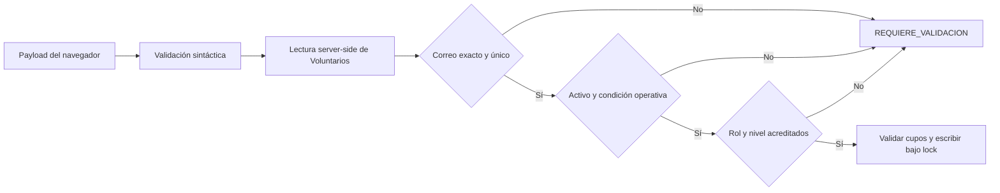
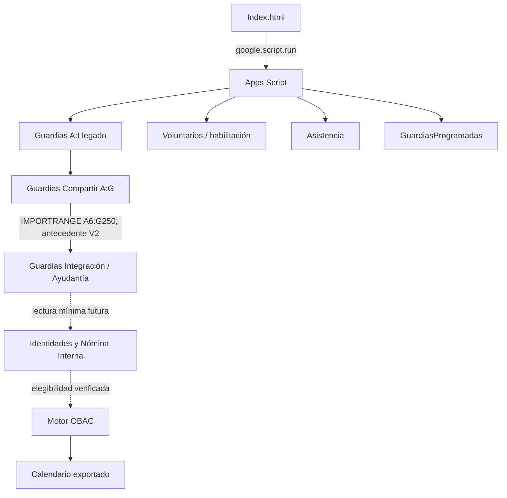

# Auditoría verificable — Sistema de Guardias 2.0

Fecha: 2026-11-14  
Rama de trabajo: `codex/guardias-v2-redesign`  
HEAD inicial: `201f0acd3b88e5dc038d25e4ccab2c0de4c3e59c`  
Alcance: repositorio local, fuentes públicas y fixtures sintéticos. **Producción no fue alterada.**

## Estado de la evidencia

| Fuente | Estado | Evidencia |
|---|---|---|
| Repositorio y tests locales | VERIFICADO | checkout de `origin/main`, suite Node y análisis estático |
| Issue público de seguridad #3 | VERIFICADO | abierto al 2026-11-14; tag `v1.1.0` todavía alcanza dos artefactos retirados |
| Documentación de deployments | VERIFICADO | Apps Script distingue versión inmutable de deployment editable; actualizar el deployment conserva ID/URL |
| Libros Guardias/Ayudantía | IDENTIFICADOS E INSPECCIONADOS | esquema productivo contrastado; las pruebas de escritura usan un libro QA sintético separado |
| Permisos de Drive | VERIFICADO SOLO EN QA | libro sintético con único permiso `user:owner`; ACL productivas no se modificaron |
| Deployments Apps Script | VERIFICADO | respaldo productivo v59, producción canónica activa en v64 y QA canónico actualizado hasta `@9` |

## Baseline

- Rama principal remota: `origin/main` en `201f0ac`.
- Tags: `v1.0.0` → `3c8ffeb`; `v1.1.0` → `c5529b9`.
- Baseline inicial: 69/69 pruebas puras y sintaxis JS correctas. Tras la implementación V2, la integridad alcanza 72 funciones cliente/servidor y 85/85 pruebas.
- Stack: Apps Script V8, HtmlService, Sheets, MailApp, CacheService y LockService.
- Manifest actual: `executeAs=USER_DEPLOYING`, `access=ANYONE_ANONYMOUS`.
- `.clasp.json`: no se versiona. Se publicaron versiones separadas en QA y producción; producción conserva el mismo deployment y URL canónicos.

## Hallazgos y riesgos

| ID | Prioridad | Hallazgo | Estado / control |
|---|---:|---|---|
| R-01 | P0 | `registrarGuardia` confiaba en `cargo` y nivel enviados por el navegador | IMPLEMENTADO localmente: autorización server-side contra `Voluntarios`, fallo seguro y tests T-A1/T-A2 |
| R-02 | P0 | `SHEET_ID`, deployment ID y URL productiva estaban versionados | IMPLEMENTADO localmente: `SHEET_ID`, `WEB_APP_URL` y `ENVIRONMENT` pasan a Script Properties; falta rotación/verificación autorizada |
| R-03 | P0 | App pública anónima expone varias funciones RPC; no existía autorización administrativa uniforme | IMPLEMENTADO parcialmente: exportación y edición de guardias exigen sesión incluida en `ADMIN_EMAILS`; falta cubrir y probar cada función de mantenimiento en Apps Script QA |
| R-04 | P0 | Antecedente de ACL `anyone` en Drive | NO VERIFICADO; remediación requiere inventario, simulación, autorización y readback |
| R-05 | P0 | Issue #3 abierto; `v1.1.0` conserva en su árbol dos archivos retirados | VERIFICADO; no se movió ni reescribió el tag |
| R-06 | P1 | Consulta/asistencia se basaban solo en correo ingresado | IMPLEMENTADO localmente: sesión activa debe coincidir exactamente; baja usa consulta interna protegida por OTP |
| R-07 | P1 | `doGet()` usaba `ALLOWALL` sin dependencia de embedding documentada | IMPLEMENTADO localmente: eliminado, vuelve la protección por defecto de HtmlService |
| R-08 | P1 | OTP de baja usaba `Math.random()` | IMPLEMENTADO localmente: UUID de plataforma + SHA-256 + rate limit/TTL existentes; pendiente prueba Apps Script QA |
| R-09 | P1 | UI usa `innerHTML` extensamente | PARCIAL: errores pasan a `textContent` y nombres/reemplazos se escapan; falta CSP/análisis contextual completo |
| R-10 | P1 | No existe modelo separado para postulantes ni cumplimiento formativo | IMPLEMENTADO: guardias formativas segregadas, sin rol/cupo/OBAC y sin modificar `Guardias!A:I` |
| R-11 | P1 | Exportador deja OBAC vacío | IMPLEMENTADO: responsable validado o `PENDIENTE DE ASIGNACIÓN` |
| R-12 | P1 | No se puede comprobar el contrato A:G ni límite 250 sin acceso a los libros | NO VERIFICADO; se debe probar con copia QA estructural |

## Cambio P0: autorización server-side

La autorización nueva sigue esta secuencia:

Reglas conservadoras implementadas:

- no hay fallback por nombre, alias parcial o apellido;
- `Activo=Si` no basta si la condición es Aspirante, Postulante, Brigadier o Pendiente;
- maquinista exige habilitación explícita o cargo de maquinista en el padrón;
- Operativo/Profesional exige un nivel acreditado igual o superior;
- ausencia de hoja, columnas obligatorias, identidad única o evidencia produce rechazo sin escritura;
- el mensaje público no revela el contenido del padrón.

El adapter prefiere el padrón enriquecido con correo y estado. Como el esquema productivo vigente carece de correo y nivel, usa de forma transitoria el último registro histórico por correo para resolver nombre, rol y nivel; una identidad sin historial falla de forma segura.

## Superficies RPC observadas

El cliente invoca funciones de configuración, calendario, registro, consulta por correo, códigos/baja, detalle diario, asistencia y exportación. El panel `AdminGuardias.html` invoca lectura/escritura de guardias programadas. Apps Script expone por nombre las funciones globales no terminadas en `_`, por lo que ocultar botones no constituye autorización.

Clasificación inicial:

| Grupo | Funciones representativas | Control requerido |
|---|---|---|
| Lectura pública operativa | `getConfig`, `obtenerCalendario`, `healthCheck` | minimizar datos, rate limit y contrato estable |
| Identidad/consulta | `detectarCorreoUsuario`, `buscarGuardiasPorEmail` | sesión/OTP; no confiar solo en correo ingresado |
| Mutación personal | `registrarGuardia`, `solicitarCodigoEliminacion`, `eliminarGuardiasPorEmail` | identidad, autorización de rol, OTP, lock, idempotencia y auditoría |
| Mutación administrativa | `guardarAsistencias`, `guardarGuardiasAdmin`, generación/exportación | autorización server-side por función y cuenta |
| Diagnóstico/mantenimiento | diagnósticos, instalación, migraciones y formato | no disponibles a visitantes anónimos |

## Flujo de datos y compatibilidad

Invariantes de migración:

- `Guardias!A:I` no cambia durante la transición;
- postulantes y OBAC se almacenarán en tablas técnicas privadas versionadas;
- la vista A:G se conserva desde fila 6 hasta probar un contrato sucesor;
- una inscripción programada nunca se traduce automáticamente en asistencia;
- hojas heredadas/ocultas no se borran ni se publican.

## Deployments y ambientes

Apps Script documenta que una versión es inmutable y un deployment posee ID/URL; para actualizar sin cambiar la URL se crea una versión y se edita el deployment existente. Ese procedimiento se verificó en QA.

| Ambiente | Script ID | Deployment ID | URL | Sheet | Estado |
|---|---|---|---|---|---|
| Preview pública | N/A | GitHub Pages | histórica `/preview/` | ninguno | VERIFICADO en repo, sintético |
| QA funcional | VERIFICADO | canónico estable `@8` | `/exec` estable | sintética privada | ACTIVO |
| Producción | VERIFICADO | canónico estable `@64` | `/exec` estable | libro real + calendario acumulativo de solo lectura | ACTIVO |

Las propiedades obligatorias por proyecto son `ENVIRONMENT`, `SHEET_ID`, `WEB_APP_URL`, `ADMIN_EMAILS`, `OBAC_ANCHOR_PERSON_ID` y opcionalmente `OBAC_SOURCE_MAX_AGE_HOURS`. QA debe fallar el preflight si el ID de hoja coincide con producción o si el banner de ambiente no es `QA`.

## Git e issue de seguridad

El issue público #3 sigue abierto. La inspección local confirma que `v1.1.0` contiene `REM_ECICEP_2026_08.xlsx` y `ODD INTERNA N°001.2026.pdf`; `git log v1.1.0 --` devuelve un commit para esas rutas. No se movió el tag, no se reescribió historia y no se hizo push. La corrección requiere una autorización separada y coordinación con consumidores del tag.

## Gate para producción

1. obtener acceso de solo lectura autorizado y reconciliar el esquema real de `Voluntarios`;
2. cerrar autorización de RPC administrativas y configurar `ADMIN_EMAILS` con confirmación del propietario;
3. comparar `Guardias | Compartir!A:G` y el `IMPORTRANGE` en copias QA estructurales;
4. probar concurrencia, correo sink, exportación y rollback;
5. revisar/remediar ACL productivas con aprobación y readback.

## Evidencia de esta iteración

- 85/85 pruebas puras PASS tras controles de rol, OBAC, postulantes y deduplicación por correo/fecha.
- Integridad frontend/backend: 72 funciones llamadas/definidas PASS.
- Sintaxis de archivos `.js`/`.mjs`: PASS.
- `git diff --check`: PASS.
- QA visual local: escritorio y 320/360/375/390/430 px; sin overflow horizontal; flujo formativo confirmado.
- QA Apps Script: libro sintético privado, banner QA, Asistencia oculta, registro formativo E2E persistido y deployment estable actualizado hasta `@8`.
- Producción: v64 cargó configuración y calendario reales con estado `Conectado`; la URL canónica no cambió.
- ACL productivas, correos reales y tags: **NO MODIFICADOS**. Proyecto Apps Script, deployment productivo y rama remota: **ACTUALIZADOS**.
